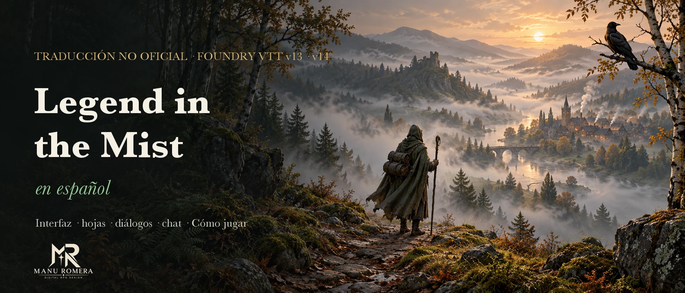
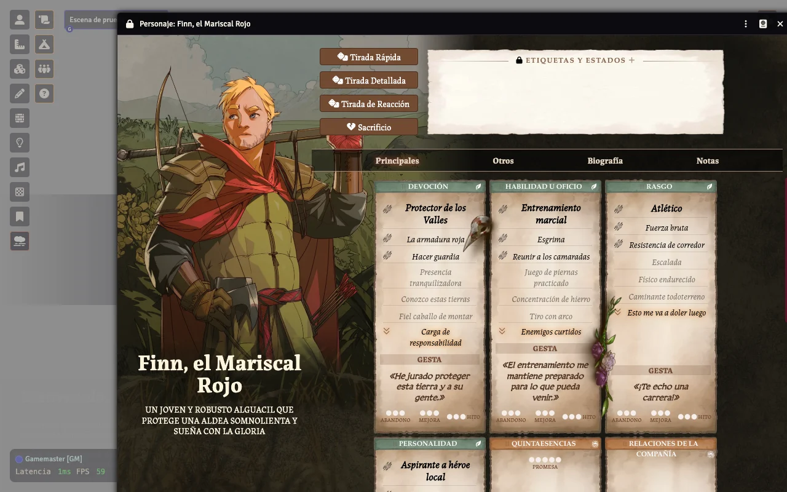
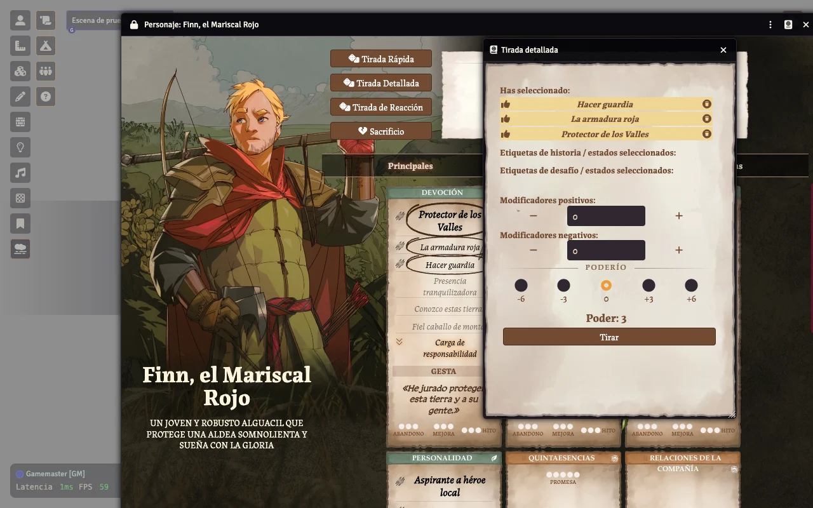
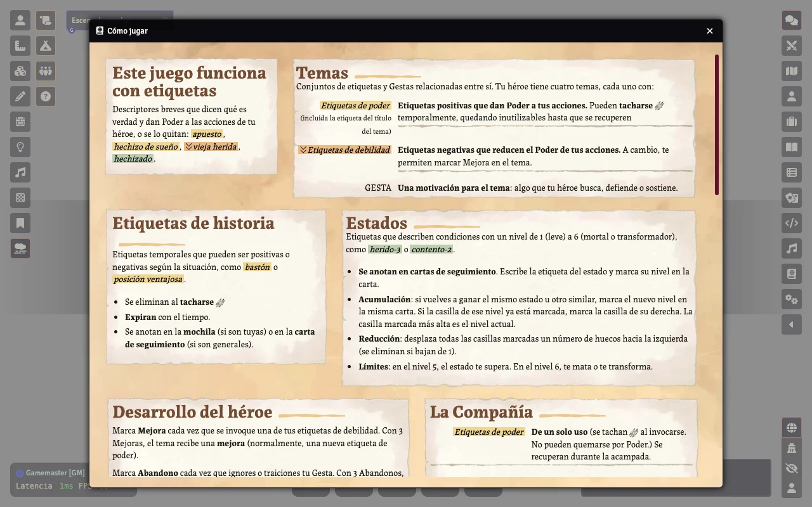

<p align="center">
  
</p>

<p align="center">
  <a href="https://github.com/ManuRomera"></a>
  <a href="https://github.com/ManuRomera/mr-litm-es/releases/latest"></a>
  
  <a href="https://github.com/ManuRomera/mr-litm-es/releases"></a>
  <a href="LICENSE"></a>
</p>

<h3 align="center">Legend in the Mist de Foundry, en español de España.<br>Para que lo único que se pierda en la niebla sea tu héroe.</h3>

---

## ⚡ Instalación en 10 segundos

Necesitas el sistema oficial **Legend In The Mist** (`mist-engine-fvtt`, ≥ 14.5.4). En Foundry: **Add-on Modules → Install Module → Manifest URL**, pega:

```
https://github.com/ManuRomera/mr-litm-es/releases/latest/download/module.json
```

Activa **MR- Legend in the Mist en español** en tu mundo y pon Foundry en **Español** (Configuración → Idioma). Nada más.

## 🖼️ Así se ve

<p align="center"></p>
<p align="center"></p>
<p align="center"></p>

## 📦 Qué traduce

| | |
|---|---|
| 🖥️ **Interfaz** | Las 487 cadenas del sistema, **revisadas y unificadas**: el idioma que trae el sistema mezclaba «DJ» y «Narrador», usaba «Poder» para Might, «Camaradería» y «Compañía»… y tenía frases mal traducidas. |
| 🧩 **Textos fijos** | Ajustes, atajos, menús del editor, diálogos, avisos y etiquetas que el sistema escribe en inglés dentro de plantillas y código (~130); se traducen al dibujar cada ventana, sin tocar el sistema. |
| 📖 **Cómo jugar** | La ventana de reglas del sistema, traducida entera (el sistema la trae como una plantilla en inglés). |
| 🧭 **Visitas guiadas** | Las dos visitas (Narrador y héroe), mensajes de acampada, acción de grupo, confirmación de tirada y sacrificio. |
| 📚 **Glosario** | Narrador, Poder / Poderío, Gesta, Compañía, Libro de tema, Mejora especial, Acampada y estancia, Tachar / Quemar… ver [`docs/GLOSARIO.md`](docs/GLOSARIO.md). |

> ℹ️ Este módulo **no** traduce los compendios del sistema (personajes pregenerados, documentación, libros de tema): su contenido no está cubierto por la licencia MIT del sistema.

## 🔧 Cómo está hecho

- `lang/es.json`: idioma del sistema, generado por `tools/lang.py` a partir del `es.json` oficial + `tools/correcciones.json` + glosario.
- `lang/literales.json` + `scripts/mr-litm-es.js`: diccionario de textos fijos y patrones con datos, aplicado a cada ventana al terminar de renderizarse (hooks `renderApplicationV2`, chat y avisos).
- `templates/how-to-play.hbs`: copia traducida de la plantilla «Cómo jugar».

## 🐛 Erratas y terminología

**Cursed Ink** prepara la edición oficial en español de Legend in the Mist y aún no ha publicado su glosario; los términos de este módulo son una propuesta y se alinearán cuando salga. Si ves un texto en inglés o una traducción mejorable, abre un [issue](https://github.com/ManuRomera/mr-litm-es/issues) con una captura.

Más módulos y sistemas de Manu Romera: [github.com/ManuRomera](https://github.com/ManuRomera).

Obra no oficial; **Legend in the Mist** es marca de Son of Oak Games. Ver [`NOTICE.md`](NOTICE.md).
